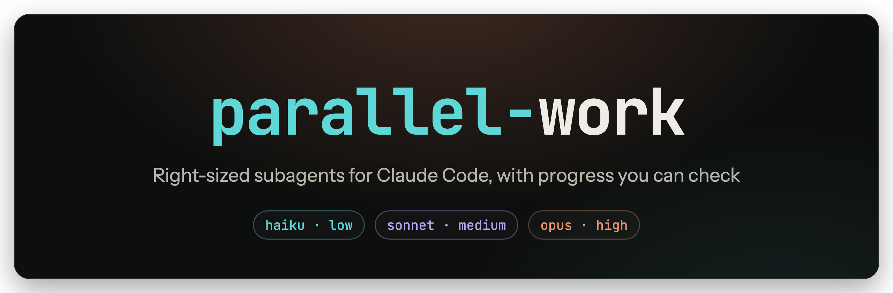
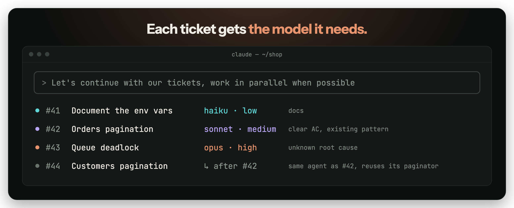
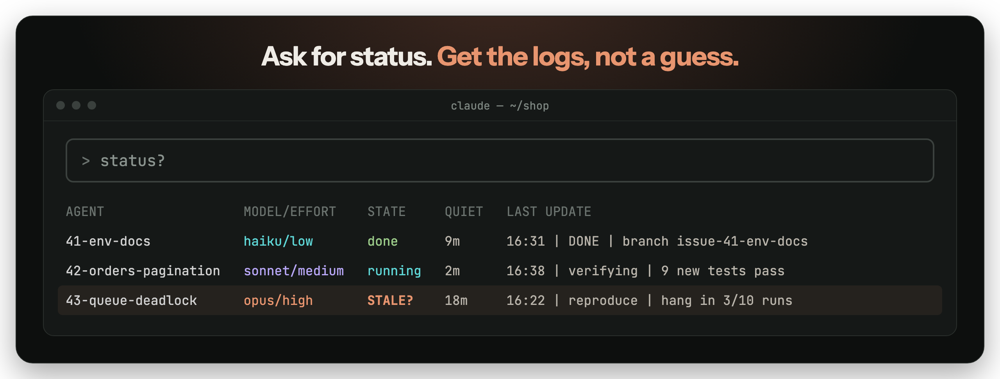
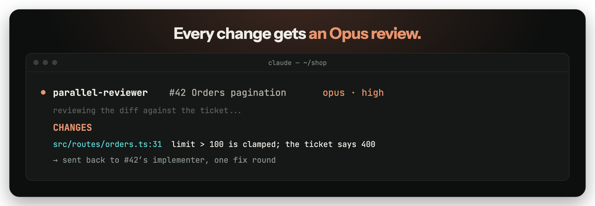
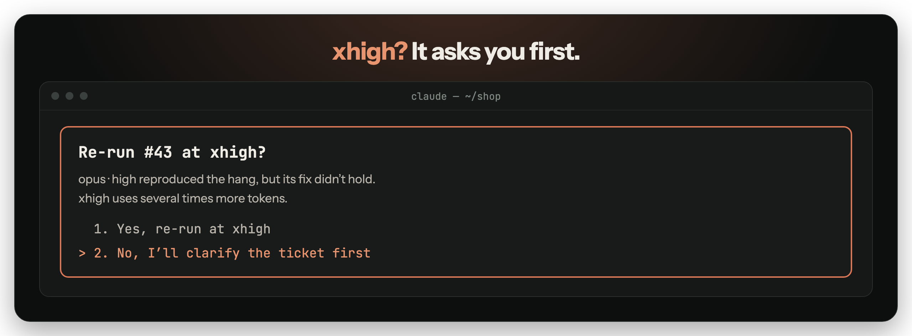
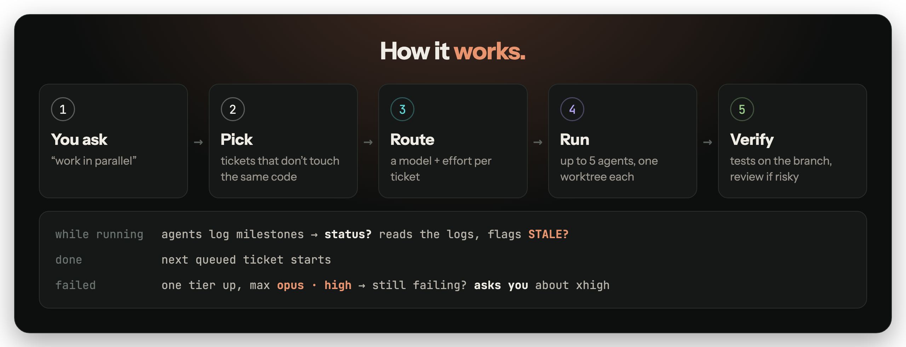

<p align="center">
  
</p>

<p align="center">
  A <a href="https://claude.com/claude-code">Claude Code</a> skill for working through a GitHub backlog with parallel subagents.<br>
  Each ticket gets the model and effort it needs, and every agent keeps a log you can check.
</p>

<p align="center">
  <a href="#install"><b>Install</b></a> &nbsp;·&nbsp;
  <a href="#routing">Routing</a> &nbsp;·&nbsp;
  <a href="#status">Status</a> &nbsp;·&nbsp;
  <a href="#review">Review</a> &nbsp;·&nbsp;
  <a href="#guardrails">Guardrails</a> &nbsp;·&nbsp;
  <a href="#how-it-works">How it works</a> &nbsp;·&nbsp;
  <a href="#customize">Customize</a>
</p>

<p align="center">
  
  <a href="LICENSE"></a>
</p>

https://github.com/user-attachments/assets/1b3c2bf0-adda-4631-a1ca-50f1383e6352

<br>

|  | Without it | With parallel-work |
|---|---|---|
| **A docs ticket** | Runs on your session's model and effort, e.g. Opus · high | `haiku · low` |
| **A deadlock with no known cause** | The same as the docs ticket | `opus · high` |
| **"How far are the agents?"** | Nobody knows until they finish | A table from the agents' own logs |
| **An agent that went quiet** | Goes unnoticed | Flagged `STALE?` after 15 minutes |
| **Code review** | The agent checks its own work, if anyone does | A fresh `opus · high` reviewer on every code change |
| **Escalating to `xhigh`** | Up to the session | Only with your yes |

## Routing



Before dispatching anything, the main session picks a model and effort level for each ticket and shows you the plan:

| Ticket looks like | Model · effort |
|---|---|
| Lookup, triage, docs, typo, rename | `haiku · low` |
| Clear acceptance criteria, follows an existing pattern | `sonnet · medium` |
| Clear spec, but tricky logic or many files | `sonnet · high` |
| Ambiguous spec, architecture, security, concurrency, unknown root cause | `opus · high` |
| Failed once at a lower tier | one tier up, at most `opus · high` |
| **Reviewing any finished code change** | `opus · high` |

When it's unsure between two rows, it takes the higher one, because a failed cheap run costs more than one right-sized run. Reviews always run on `opus · high`: the cheap model does the long work, and the strong one checks it. Tickets that touch the same code, or build on each other, go to one agent in order.

## Status



Every subagent appends a line to `.parallel-work/agents/<ticket>.log` at each milestone. Ask **status?** and the main session runs [`scripts/status.sh`](scripts/status.sh) and reports what the logs say.

An agent with no log line for 15 minutes shows as `STALE?`. The main session then checks that agent's working copy for recent changes, so you hear whether it's still busy or actually stuck.

## Review



Implementers run on the cheapest model that fits. Every code change is then checked by a fresh `parallel-reviewer` on **`opus · high`**, so tokens are saved on the long work but not on correctness. Docs and typo tickets (`haiku` tier) skip review.

- **The reviewer judges the code, not the story.** It gets the ticket's acceptance criteria and the diff, never the implementer's explanation. A "friendlier" take on a criterion counts as a finding.
- **It can't edit anything.** It has no edit tools and only replies `PASS` or `CHANGES` with `file:line` findings.
- **Findings go back to the original implementer**, which still has its context, for one fix round. Then the same reviewer checks again.
- **Two rejections and it stops.** You get the open findings and the unpushed branch, and you decide what happens next.

## Guardrails



- **`xhigh` and `max` need your yes, every time.** When an `opus · high` run fails, Claude says what it learned and asks whether to spend several times the tokens, or whether you'd rather clarify the ticket. It keeps the other tickets moving while it waits.
- **At most 5 subagents at once**, unless you say otherwise ("use 8 subagents", "as many as possible"). The rest are queued and start as slots free up.
- **Each agent gets its own git worktree**, so parallel edits never collide.
- **Nothing is pushed before the review passes.** Implementers only commit. The main session pushes, and opens a PR only if you've asked for PRs (in the session or in `CLAUDE.md`).

## Agent types

The skill ships two subagent types, so you can see in the UI who's doing what:

| Agent | Does | Defaults | Tools |
|---|---|---|---|
| [`parallel-implementer`](agents/parallel-implementer.md) | One ticket, in its own git worktree. Commits, never pushes. | `sonnet · medium`, overridden per ticket | All |
| [`parallel-reviewer`](agents/parallel-reviewer.md) | Checks a finished diff against the ticket. Replies PASS or CHANGES. | `opus · high` | Read, Grep, Glob, Bash (no editing) |

## How it works



## Install

Ask Claude Code:

> Install the skill from https://github.com/DannyKuk/parallel-work, including its agents

Or clone it into your skills folder and link the two agent types:

```sh
git clone https://github.com/DannyKuk/parallel-work ~/.claude/skills/parallel-work
mkdir -p ~/.claude/agents && ln -sf ~/.claude/skills/parallel-work/agents/*.md ~/.claude/agents/
```

Restart Claude Code if `~/.claude/agents/` didn't exist before. Without the agents, the skill still works using `general-purpose` subagents.

Update with `git -C ~/.claude/skills/parallel-work pull`. New sessions pick up changes; running ones keep the version they started with.

Requires `git` and the [GitHub CLI](https://cli.github.com) (`gh`), logged in to the repo you're working on.

**Windows:** works through Git Bash, which Claude Code on Windows already requires. Git Bash's `ln -s` copies files instead of linking them, so copy the agents with `cp` and copy them again after each update.

## Usage

The skill activates only when you ask for parallel work. A plain "let's continue" leaves it out.

```text
> Let's continue with our tickets, work in parallel when possible
> Do #12, #13 and #14 at the same time with subagents
> status?
```

## Customize

| What | Where |
|---|---|
| Routing rules | [`SKILL.md`](SKILL.md), section 2. For example, send anything touching auth to `opus`. |
| Concurrency cap | [`SKILL.md`](SKILL.md), section 1, "At most 5 subagents" |
| Stale threshold | `STALE_MIN=20 bash scripts/status.sh` (default 15 minutes) |

Logs live in `.parallel-work/` at the repo root. The skill adds that folder to `.git/info/exclude`, so it never gets committed.

## FAQ

<details>
<summary><b>Why not run everything on Opus?</b></summary>
<br>
You can, by editing the routing table. Smaller models finish easy tickets faster and use much less of your usage limits, so the budget goes to the tickets that need it.
</details>

<details>
<summary><b>My session runs on Sonnet. Does routing still work?</b></summary>
<br>
Yes. Every subagent gets its model and effort set explicitly, so a hard ticket can still go to Opus while your main session stays on Sonnet.
</details>

<details>
<summary><b>What if an agent can't write its log?</b></summary>
<br>
Some sandbox setups block writes outside the agent's worktree. The agent then keeps working and lists its milestones in its final report, and the main session falls back to checking the worktree for changes.
</details>

## License

[MIT](LICENSE). Contributions and issues are welcome.
